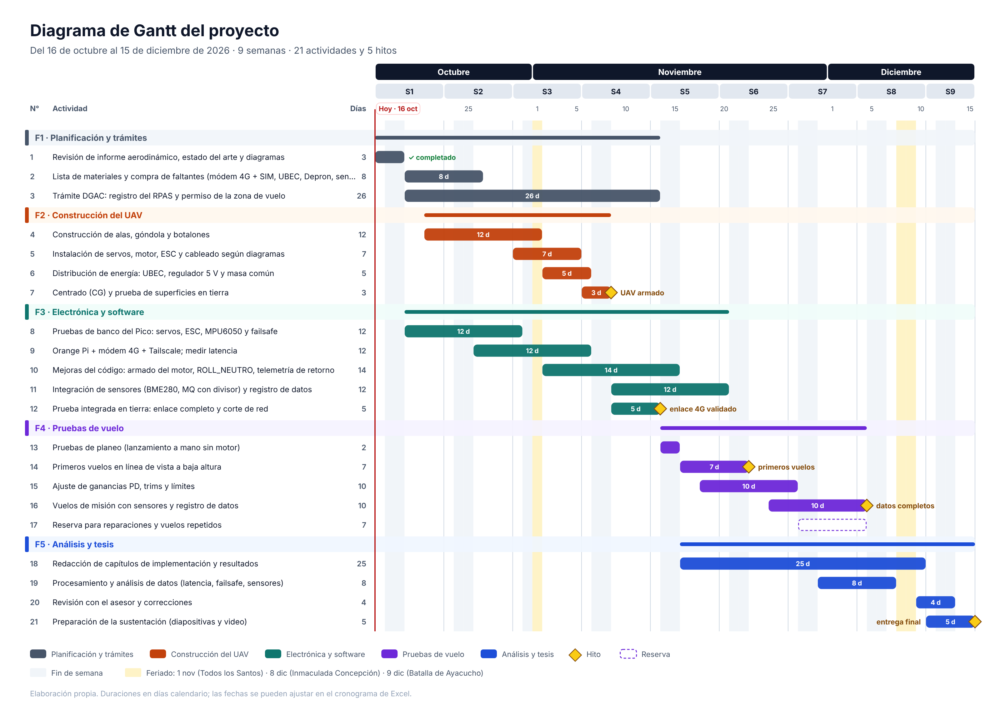

# Cronograma y Diagrama de Gantt

> Plan de trabajo de 9 semanas, del **16 de octubre al 15 de diciembre de 2026**: 21 actividades en 5 fases y 5 hitos.

* 📊 **Cronograma editable:** [`Cronograma_UAV_4G_LTE.xlsx`](Cronograma_UAV_4G_LTE.xlsx)
* 🖼️ **Diagrama de Gantt:** [`11_diagrama_gantt.png`](../../Resources/Software/Imagenes/diagramas/11_diagrama_gantt.png) (versión vectorial en [`svg/`](../../Resources/Software/Imagenes/diagramas/svg/11_diagrama_gantt.svg))

  

---

## 1. Fases

| Fase | Fechas | Qué incluye |
| :--- | :--- | :--- |
| **F1 · Planificación y trámites** | 16 oct – 13 nov | Revisión de documentos base, compra de faltantes, **trámite DGAC** en paralelo |
| **F2 · Construcción del UAV** | 21 oct – 8 nov | Alas, góndola y botalones; servos, motor, ESC y cableado; energía; centrado (CG) |
| **F3 · Electrónica y software** | 19 oct – 20 nov | Pruebas de banco del Pico, Orange Pi + 4G + Tailscale, mejoras del código, sensores, prueba de corte de red |
| **F4 · Pruebas de vuelo** | 14 nov – 4 dic | Planeo sin motor, primeros vuelos en línea de vista, ajuste del PD, vuelos con sensores, 1 semana de reserva |
| **F5 · Análisis y tesis** | 16 nov – 15 dic | Redacción, análisis de datos, revisión con el asesor y sustentación |

## 2. Actividades

| N° | Fase | Actividad | Inicio | Fin | Días | Entregable |
| :---: | :---: | :--- | :---: | :---: | :---: | :--- |
| 1 | F1 | Revisión de informe aerodinámico, estado del arte y diagramas | 16/10 | 18/10 | 3 | Documentos base listos ✅ |
| 2 | F1 | Lista de materiales y compra de faltantes (módem 4G + SIM, UBEC, Depron, sensores) | 19/10 | 26/10 | 8 | Materiales en mano |
| 3 | F1 | Trámite DGAC: registro del RPAS y permiso de la zona de vuelo | 19/10 | 13/11 | 26 | Constancia de registro |
| 4 | F2 | Construcción de alas, góndola y botalones | 21/10 | 01/11 | 12 | Estructura terminada |
| 5 | F2 | Instalación de servos, motor, ESC y cableado según diagramas | 30/10 | 05/11 | 7 | Aviónica instalada |
| 6 | F2 | Distribución de energía: UBEC, regulador 5 V y masa común | 02/11 | 06/11 | 5 | Energía probada |
| 7 | F2 | Centrado (CG) y prueba de superficies en tierra | 06/11 | 08/11 | 3 | 🔶 **Hito: UAV armado** |
| 8 | F3 | Pruebas de banco del Pico: servos, ESC, MPU6050 y failsafe | 19/10 | 30/10 | 12 | `main1.py` validado |
| 9 | F3 | Orange Pi + módem 4G + Tailscale; medir latencia | 26/10 | 06/11 | 12 | Enlace 4G operativo |
| 10 | F3 | Mejoras del código: armado del motor, `ROLL_NEUTRO`, telemetría de retorno | 02/11 | 15/11 | 14 | Código v2 |
| 11 | F3 | Integración de sensores (BME280, MQ con divisor) y registro de datos | 09/11 | 20/11 | 12 | Sensores funcionando |
| 12 | F3 | Prueba integrada en tierra: enlace completo y corte de red | 09/11 | 13/11 | 5 | 🔶 **Hito: enlace 4G validado** |
| 13 | F4 | Pruebas de planeo (lanzamiento a mano sin motor) | 14/11 | 15/11 | 2 | Planeo estable |
| 14 | F4 | Primeros vuelos en línea de vista a baja altura | 16/11 | 22/11 | 7 | 🔶 **Hito: primeros vuelos** |
| 15 | F4 | Ajuste de ganancias PD, trims y límites | 18/11 | 27/11 | 10 | Parámetros finales |
| 16 | F4 | Vuelos de misión con sensores y registro de datos | 25/11 | 04/12 | 10 | 🔶 **Hito: datos completos** |
| 17 | F4 | Reserva para reparaciones y vuelos repetidos | 28/11 | 04/12 | 7 | Margen de seguridad |
| 18 | F5 | Redacción de capítulos de implementación y resultados | 16/11 | 10/12 | 25 | Borrador de tesis |
| 19 | F5 | Procesamiento y análisis de datos (latencia, failsafe, sensores) | 30/11 | 07/12 | 8 | Resultados |
| 20 | F5 | Revisión con el asesor y correcciones | 10/12 | 13/12 | 4 | Tesis corregida |
| 21 | F5 | Preparación de la sustentación (diapositivas y video) | 11/12 | 15/12 | 5 | 🔶 **Hito: entrega final** |

## 3. Criterios del plan

* **El trámite DGAC empieza la primera semana:** es lo único que no depende del equipo y puede frenar los vuelos.
* **Construcción y pruebas de banco del código van en paralelo** para ganar tiempo.
* **Una semana de reserva** (28 nov – 4 dic) para reparaciones tras los primeros vuelos.
* **Feriados** (calendario oficial 2026): 1 de noviembre (domingo), 8 y 9 de diciembre. La revisión con el asesor empieza después de ellos.

## 4. Cómo usar el Excel

* Solo se editan las celdas **amarillas**: Inicio, Fin y Estado (lista: Pendiente / En curso / Completado).
* Las barras del Gantt se redibujan solas por formato condicional; las actividades completadas se pintan de verde.
* Cada fase resume su rango de fechas y cuántas actividades lleva completadas.
* Hojas: **Cronograma**, **Hitos** (enlazada) y **Feriados** (se pueden agregar días no laborables).
* Listo para imprimir en A4 horizontal.
