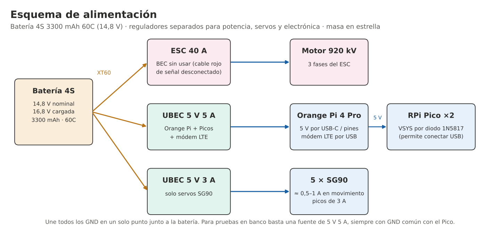
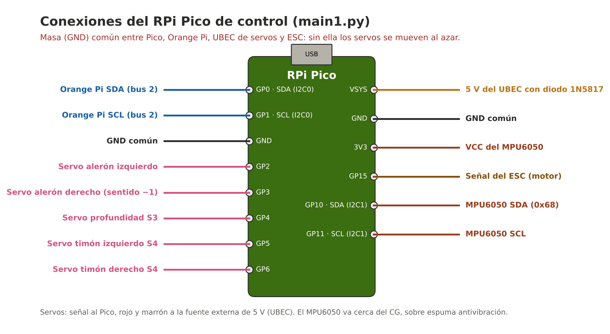
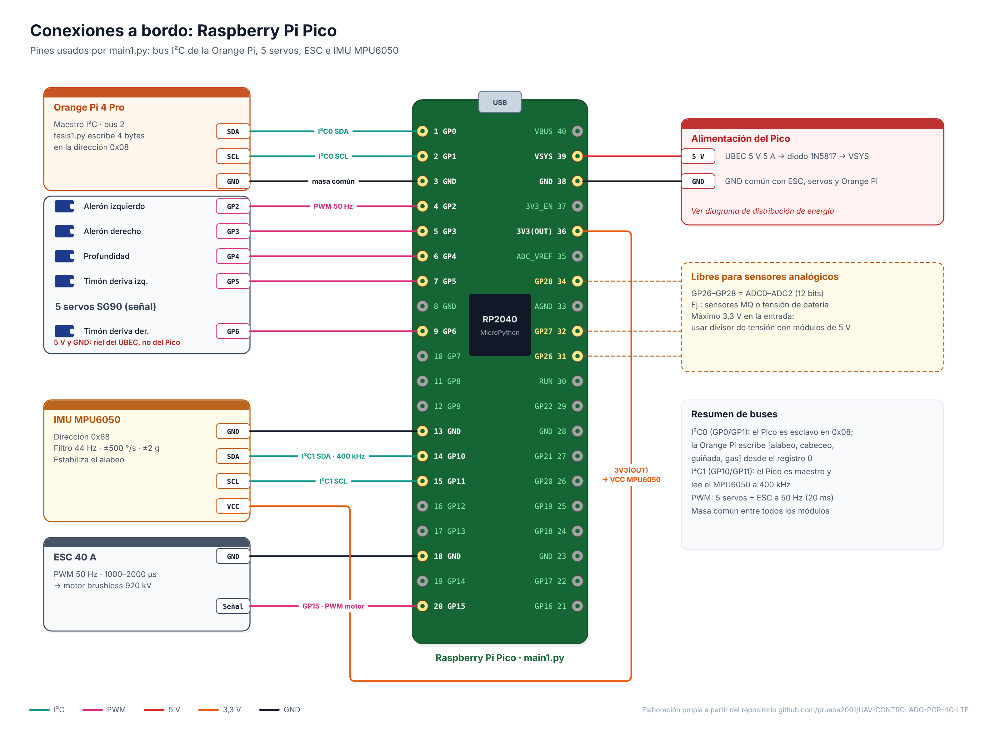

# UAV Alapalap 4S — Electrónica

> Componentes, alimentación, conexiones del RPi Pico y problemas resueltos durante las pruebas en banco.

---

## 1. Componentes

| Componente | Función |
| :--- | :--- |
| Batería 4S 3300 mAh 60C (241 g) | Alimentación de todo el avión (14,8 V nominal) |
| Motor brushless 4S 920 kV + ESC 40 A | Propulsión (hélice propulsora detrás del ala) |
| Orange Pi 4 Pro | Computadora de misión: recibe UDP por Tailscale y escribe por I2C al Pico |
| Módem LTE + SIM | Conexión a internet celular de la Orange Pi |
| RPi Pico #1 | Controlador de vuelo: 5 servos, ESC, MPU6050, failsafe |
| MPU6050 | Giroscopio + acelerómetro para estabilizar el alabeo |
| RPi Pico #2 (opcional) | Sensores de gases tipo MQ, separado del control de vuelo |
| 5 × servo SG90 | 2 alerones, 1 profundidad, 2 timones |
| UBEC 5 V 5 A y UBEC 5 V 3 A | 5 V para la electrónica y para los servos, por separado |
| Diodo 1N5817 | Entrada a VSYS del Pico (permite conectarlo por USB sin conflicto) |

---

## 2. Alimentación

  

* El BEC del ESC no se usa para la electrónica: los servos y la Orange Pi tienen su propio regulador.
* Todas las masas (GND) se unen en un solo punto (estrella) junto a la batería.
* **Pruebas en banco:** la Orange Pi 4 Pro alimentada con una fuente de 5 V 5 A puede dar 5 V a uno o dos SG90 desde sus pines de 5 V. Para los 5 servos, o si además se conecta una cámara USB, conviene sacar los servos directo de la fuente o de un UBEC, porque un servo trabado puede pedir más de 1 A y reiniciar la Orange Pi.

---

## 3. Conexiones del RPi Pico

  

| Pin del Pico | Conexión |
| :--- | :--- |
| GP0 (SDA, I2C0) | SDA del bus I2C 2 de la Orange Pi |
| GP1 (SCL, I2C0) | SCL del bus I2C 2 de la Orange Pi |
| GP2 | Servo alerón izquierdo |
| GP3 | Servo alerón derecho |
| GP4 | Servo profundidad S3 |
| GP5 | Servo timón izquierdo S4 |
| GP6 | Servo timón derecho S4 |
| GP15 | Señal del ESC |
| GP10 (SDA, I2C1) | SDA del MPU6050 (dirección 0x68) |
| GP11 (SCL, I2C1) | SCL del MPU6050 |
| 3V3 | VCC del MPU6050 |
| VSYS | 5 V del UBEC a través del 1N5817 |
| GND | Masa común |

El MPU6050 va en su propio bus (I2C1) porque el I2C0 del Pico funciona como esclavo de la Orange Pi. Colócalo cerca del CG, sobre espuma, con su eje X a lo largo del avión.

---

## 4. Problemas Resueltos en las Pruebas

| Síntoma | Causa | Solución |
| :--- | :--- | :--- |
| Thonny: *Device is busy* | Otro programa tiene abierto el puerto del Pico | Cerrar el otro programa o el monitor serial y reconectar |
| `lector_serial`: no existe `/dev/ttyACM0` | El Arduino aparece en otro puerto (ej. `ttyACM1`) | Revisar con `ls -l /dev/serial/by-id/` y poner ese puerto en `PUERTO` |
| `Transmisor1.py` corre pero `tesis1.py` dice *sin dato UDP* | IP de destino equivocada | Poner en `IP_RECEPTOR` la IP de Tailscale de la Orange Pi (`tailscale ip -4`) |
| Motor responde pero los servos se mueven al azar | La fuente externa de los servos no compartía masa con el Pico | Unir el GND de la fuente externa con el GND del Pico |
| Una superficie se mueve al revés | Montaje del servo | Cambiar su `sentido` en `SERVOS_CFG` o su `INVERTIR_…` en `tesis1.py` |

---

## 5. Orden de Encendido

1. Quitar la hélice en cualquier prueba en banco.
2. Conectar la batería: el Pico centra los servos y deja el ESC al mínimo durante 3 s.
3. Dejar el avión quieto durante 1 s mientras el Pico calibra el giroscopio.
4. Iniciar `tesis1.py` en la Orange Pi y después `Transmisor1.py` en la laptop.
5. Comprobar que el mensaje *Enlace con el maestro establecido* aparece antes de dar gas.

---

## 6. Diagramas de Electrónica

Hechos a partir de los códigos definitivos y de este mismo documento. Explicación completa en [`Resources/Software/docs/DIAGRAMAS.md`](../../Resources/Software/docs/DIAGRAMAS.md).

  

| Diagrama | Contenido |
| :--- | :--- |
| [01 · Arquitectura general](../../Resources/Software/Imagenes/diagramas/01_arquitectura_general.png) | Tierra, red 4G con Tailscale y aviónica a bordo |
| [02 · Estación terrena](../../Resources/Software/Imagenes/diagramas/02_conexiones_estacion_terrena.png) | Joysticks a A0–A3 del Arduino y USB a la laptop |
| [03 · Pines del Pico](../../Resources/Software/Imagenes/diagramas/03_conexiones_pico.png) | Los 40 pines, buses I²C, PWM, VSYS y ADC libres (GP26–GP28) |
| [04 · Distribución de energía](../../Resources/Software/Imagenes/diagramas/04_distribucion_energia.png) | Batería 4S, ESC, UBEC 3 A (servos), UBEC 5 A (electrónica) y masa común |
| [10 · Failsafe](../../Resources/Software/Imagenes/diagramas/10_linea_tiempo_failsafe.png) | Qué pasa, segundo a segundo, si se corta la red |

> [!WARNING]
> Los módulos de sensores MQ entregan hasta 5 V por su salida analógica; el ADC del Pico admite como máximo 3,3 V. Usar divisor de tensión o conversor externo antes de GP26–GP28.

