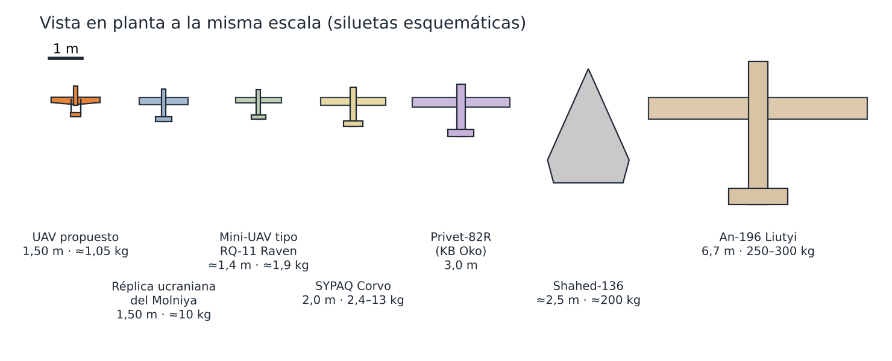
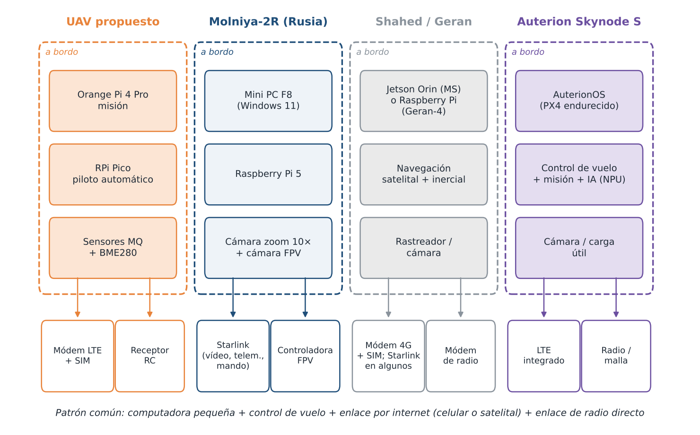

# Estado del Arte — UAV de bajo costo en defensa y seguridad

> Revisión de los sistemas recientes de defensa y seguridad que usan la misma arquitectura que este proyecto (computadora comercial a bordo, controlador de vuelo, módem 4G con SIM, enlaces por internet y estructuras baratas), más los sensores de uso común en plataformas Arduino y universitarias.

📄 **Documento completo:** [`Resources/Software/Estado_del_arte_UAV_4G_LTE.pdf`](../../Resources/Software/Estado_del_arte_UAV_4G_LTE.pdf) (19 páginas, 8 figuras, 10 tablas, 47 referencias) · versión editable en [`.docx`](../../Resources/Software/Estado_del_arte_UAV_4G_LTE.docx)

> [!NOTE]
> Los casos se describen únicamente por su arquitectura, estructura, componentes y enlaces de comunicación, según fuentes abiertas. Se omiten a propósito los aspectos de armamento y empleo táctico, que no son pertinentes para una plataforma de medición ambiental que opera bajo el marco civil de la DGAC.

---

## 1. Contenido del documento

| N° | Sección | Idea clave |
| :---: | :--- | :--- |
| 1 | Introducción, alcance y método | Fuentes abiertas revisadas en octubre de 2026 |
| 2 | Mini-UAV tácticos lanzados a mano (tipo RQ-11 Raven) | Misma clase de masa (≈1,4 m, ≈1,9 kg); lanzamiento a mano y aterrizaje en panza |
| 3 | Molniya (Rusia) y su réplica ucraniana | Tubos de aluminio y contrachapado; la réplica ucraniana tiene **1,5 m de envergadura**, igual que este UAV |
| 4 | Molniya-2R | **Raspberry Pi 5 + minicomputadora + Starlink**: la misma arquitectura de este proyecto a mayor escala |
| 5 | KB Oko (Rusia): familia Privet-82 | Controlador de vuelo propio (**Baklan-1**) y tramos largos sin enlace |
| 6 | SYPAQ Corvo PPDS (Australia / Ucrania) | **Placa de espuma encerada**, armada con cinta y pegamento, software abierto, vuela sin enlace |
| 7 | Shahed / Geran | **Módems 4G con SIM comerciales** para telemetría; Jetson Orin y Raspberry Pi a bordo |
| 8 | SkyRiper Minotaur (Ucrania) | **Mando por 3G/4G con túnel VPN**, Raspberry Pi 5 y modo autónomo al perder la señal |
| 9 | Auterion OS y Skynode | PX4 endurecido; un solo módulo con control de vuelo, misión, IA y LTE |
| 10 | Equivalentes ucranianos y síntesis | Tabla comparativa de todos los casos |
| 11 | Sensores de uso común en Arduino y universidades | Serie MQ, MiCS-6814, CCS811, SGP, BME680, MH-Z19, SCD30/41, DHT, SHT, BME280, MS5611, MS4525DO, PMS5003 |
| 12 | Enlaces: SIM/LTE y satélite | Fiabilidad LTE (88,5–98,5 % con una red), Starlink solo en aviones de ≈10 kg o más |
| 13 | Marco regulatorio en el Perú | Ley 30740, NTC 001-2015, nuevo Reglamento de RPAS (2026) |
| 14 | Posicionamiento del UAV propuesto | Comparación punto por punto |
| 15 | Conclusiones y recomendaciones | Ver abajo |

---

## 2. Precedentes revisados

| Sistema | Origen | Tamaño / masa | Computadora a bordo | Enlace | Paralelo con este UAV |
| :--- | :--- | :--- | :--- | :--- | :--- |
| Mini-UAV tipo RQ-11 Raven | EE. UU. | ≈1,4 m · ≈1,9 kg | Autopiloto integrado | Radio | Misma clase de masa |
| Molniya / réplica ucraniana | Rusia / Ucrania | 1,5 m · ≈10 kg | Controladora FPV | Radio + vídeo FPV | Misma envergadura |
| Molniya-2R | Rusia | Clase de ≈10 kg | Raspberry Pi 5 + Mini PC F8 | Starlink | Misma arquitectura Pi + PC + internet |
| Privet-82 (KB Oko) | Rusia | ≈6 kg · ≈30 km | Controlador propio Baklan-1 | Radio; tramos sin enlace | Controlador de vuelo propio |
| SYPAQ Corvo PPDS | Australia; uso en Ucrania | 2 m · 2,4 kg vacío | Hardware comercial + software abierto | Sin enlace (navegación a estima + GPS) | Espuma como el Depron |
| Shahed / Geran | Irán / Rusia | ≈200 kg | Rastreador; Jetson Orin; Raspberry Pi | Módem 4G + SIM; Starlink en algunos | Telemetría por SIM comercial |
| SkyRiper Minotaur | Ucrania | 14 kg · 25 km | Raspberry Pi 5 o Vision | UMTS/LTE con VPN | Mando por LTE + VPN, como Tailscale |
| Auterion Skynode S | EE. UU. / Alemania | Módulo | AuterionOS (PX4) + NPU | LTE integrado | Integra Orange Pi + Pico + LTE |
| An-196 Liutyi | Ucrania | 6,7 m · 250–300 kg | Navegación con IA | Satelital + inercial | Solo referencia de escala |

  

  

---

## 3. Conclusiones principales

1. **La arquitectura está validada por precedentes del ámbito de defensa.** Raspberry Pi o minicomputadora, módem con SIM y enlace por internet funcionan en aviones baratos producidos en serie.
2. **Adoptar PX4 o ArduPilot** en lugar de un piloto automático propio en el Pico, como hace la industria con Auterion OS.
3. **Usar el LTE como lo hace el Minotaur:** cifrado por VPN (Tailscale/WireGuard) y con modo autónomo al perder la señal.
4. **Descartar Starlink** en un avión de 1 kg: el terminal pesa casi lo mismo que todo el avión.
5. **Mejorar los sensores dentro del ecosistema Arduino:** mantener los MQ como detectores cualitativos y añadir un electroquímico o MiCS-6814 para CO, un SCD41 o MH-Z19B para CO₂, un SHT45/SHT31 con escudo solar y un Pitot MS4525DO. Los módulos MQ de 5 V necesitan **divisor de tensión** antes del ADC de 3,3 V del Pico.
6. **Operar como aeronave civil:** registro ante la DGAC, por debajo de 152 m y en línea de vista hasta contar con autorización.

---

## 4. Figuras del documento

Todas en [`Resources/Software/Imagenes/estado_del_arte/`](../../Resources/Software/Imagenes/estado_del_arte/):

| Figura | Archivo |
| :--- | :--- |
| Línea de tiempo de los precedentes de defensa y seguridad | [`f_tiempo.png`](../../Resources/Software/Imagenes/estado_del_arte/f_tiempo.png) |
| Siluetas a la misma escala | [`f_escala.png`](../../Resources/Software/Imagenes/estado_del_arte/f_escala.png) |
| Arquitectura comparada (este UAV, Molniya-2R, Shahed/Geran, Skynode S) | [`f_arquitectura.png`](../../Resources/Software/Imagenes/estado_del_arte/f_arquitectura.png) |
| Masa frente a envergadura | [`f_masa.png`](../../Resources/Software/Imagenes/estado_del_arte/f_masa.png) |
| Toma de muestra en ala fija frente a multirrotor | [`f_toma.png`](../../Resources/Software/Imagenes/estado_del_arte/f_toma.png) |
| Enlaces: masa a bordo frente a caudal | [`f_enlaces.png`](../../Resources/Software/Imagenes/estado_del_arte/f_enlaces.png) |
