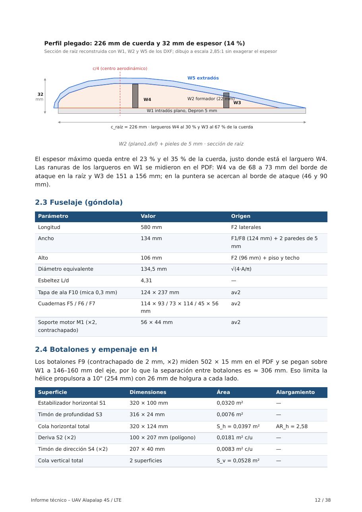

# Informe técnico aerodinámico — UAV Alapalap 4S / LTE

[`Informe_tecnico_UAV_Alapalap_4S_LTE.pdf`](Informe_tecnico_UAV_Alapalap_4S_LTE.pdf) · 38 páginas

  

## Contenido
1. Introducción, objetivos y alcance
2. Marco teórico de los cálculos
3. Geometría de la aeronave (planos A0 y DXF)
4. Presupuesto de masas y peso de despegue (MTOW)
5. Condiciones atmosféricas de diseño y número de Reynolds (Chosica, 850 m, 25 °C)
6. Aerodinámica del ala
7. Resistencia aerodinámica y polar
8. Planta propulsora 4S 920 kV
9. Actuaciones
10. Energía y autonomía
11. Lanzamiento a mano y aterrizaje sin tren
12. Estabilidad estática longitudinal
13. Estabilidad direccional y lateral
14. Estabilidad dinámica longitudinal
15. Estructura y cargas
16. Integración de aviónica, LTE y sensores
17. Conclusiones, riesgos y recomendaciones

## Conclusiones principales
* La conversión es viable: ≈ 1050 g de peso, pérdida a 8,1 m/s, estable con el CG entre 45 y 50 mm y ≈ 30 min de vuelo a 12 m/s.
* La hélice se elige según la corriente que admite la batería; el informe compara 8×4, 9×4,5 y 10×5.
* Sin tren de aterrizaje hay que proteger la hélice al aterrizar en panza (freno del ESC, hélice plegable o patín).
* El control de vuelo queda en el RPi Pico; la Orange Pi es solo la computadora de misión.
* Primer vuelo con el CG a 45 mm, sensores apagados y modo manual (`ROLL_NEUTRO = True`).

Cálculos previos: [Google Drive](https://drive.google.com/file/d/1UdGnhi0XhoKIerkP7uhXoAIDbuv5v3hw/view?usp=sharing)
