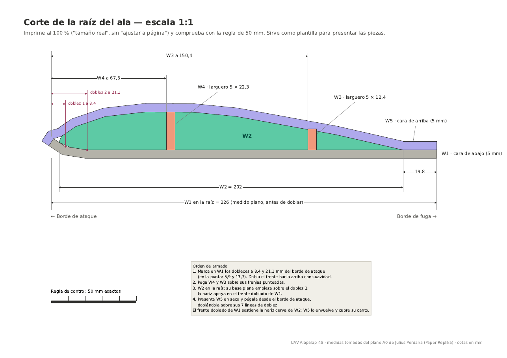
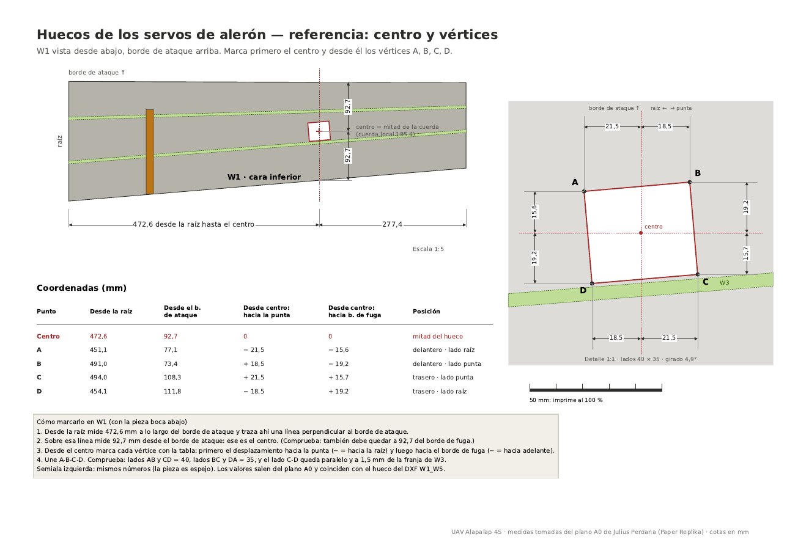
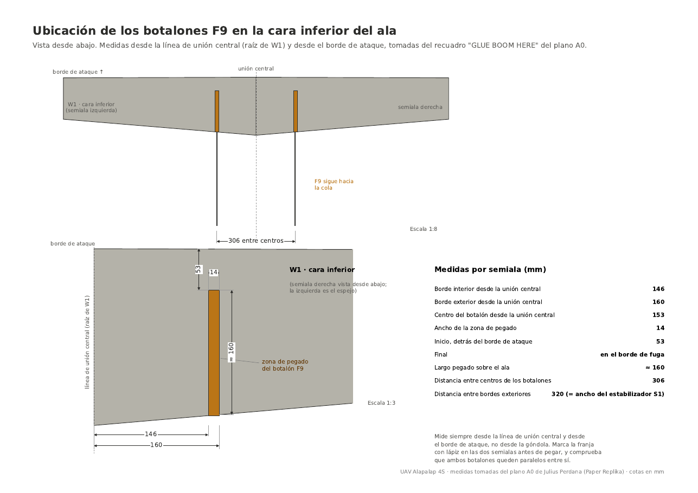
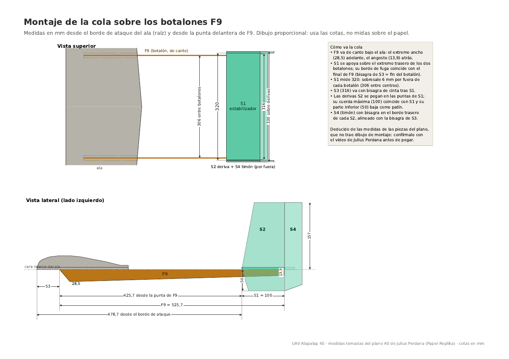
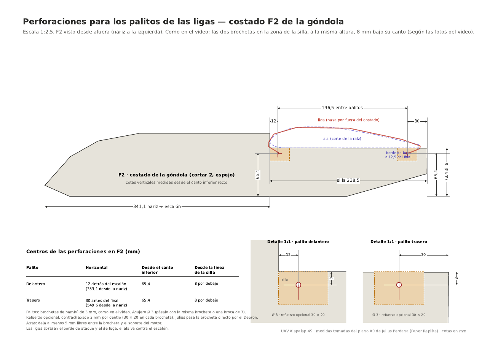

# UAV Alapalap 4S — Mecánica y Armado

> Guía de construcción con las medidas sacadas del plano A0 de Julius Perdana y las modificaciones de este proyecto. Todas las cotas en mm. Los planos completos están en [`ArchivosCAD/Planos/`](../../ArchivosCAD/Planos/).

---

## 1. Materiales

* Depron / polyfoam de 5 mm para ala, góndola y cola.
* Contrachapado para los botalones F9 y el refuerzo central W6 (este proyecto usa ≈ 4 mm en F9, el original 2 mm).
* Pegamento caliente, CA y pegamento para espuma; cinta de embalaje.
* Brochetas de bambú de 3–4 mm para sujetar el ala con ligas.
* Varilla de acero de 1 mm para los mandos.

---

## 2. Ala

  

| Pieza | Función | Medidas clave |
| :--- | :--- | :--- |
| **W1** | Cara de abajo | Raíz 226, punta 161,5, largo 750. Dos dobleces: 8,4 y 21,1 desde el borde de ataque en la raíz (5,9 y 13,7 en la punta) |
| **W2** | Formador del perfil en la raíz | Largo 202. Su base plana empieza sobre el doblez de 21,1; termina a 19,8 del borde de fuga |
| **W4** | Larguero delantero (5 × 22,3) | A 67,5 del borde de ataque en la raíz, 43,5 en la punta |
| **W3** | Larguero trasero (5 × 12,4) | A 150,4 del borde de ataque en la raíz, 89 en la punta |
| **W5** | Cara de arriba | Raíz 233,8, punta 170,3. Siete líneas de doblez; envuelve el borde de ataque |
| **W6** | Unión central de contrachapado | 334,9 × 32,1, diedro 3,4° |
| Alerón | Se separa cortando W5 y W1 | 313,3 de largo, cuerda 50,1 → 40,0 |

**Orden:** marcar y doblar W1 → pegar W4 y W3 sobre sus franjas → pegar W2 en la raíz → presentar W5 en seco y pegarla desde el borde de ataque, doblándola por sus líneas. El borde de fuga queda romo; se puede lijar a bisel, pero no es obligatorio.

---

## 3. Huecos de los Servos de Alerón

  

* Un hueco por semiala en W1, de **40 × 35** (40 en el sentido de la envergadura), girado 4,9° para quedar paralelo a W3.
* **Centro:** 472,6 desde la raíz y 92,7 desde el borde de ataque (mitad de la cuerda local de 185,4).

| Vértice | Desde el centro: hacia la punta | Desde el centro: hacia el borde de fuga | Desde la raíz | Desde el borde de ataque |
| :---: | :---: | :---: | :---: | :---: |
| A (delantero, lado raíz) | −21,5 | −15,6 | 451,1 | 77,1 |
| B (delantero, lado punta) | +18,5 | −19,2 | 491,0 | 73,4 |
| C (trasero, lado punta) | +21,5 | +15,7 | 494,0 | 108,3 |
| D (trasero, lado raíz) | −18,5 | +19,2 | 454,1 | 111,8 |

* El SG90 va **acostado de lado** (12,2 mm de alto), con el eje hacia la punta y el brazo asomando por debajo. Parado no cabe: el ala solo tiene 17–22 mm de alto por dentro en esa zona.
* Varilla de 1 mm con doblez en Z hasta un horn pegado bajo el alerón (≈ 36 mm).
* El cable va por dentro entre W4 y W3 hasta la raíz, con un alargador de 30 cm.

---

## 4. Botalones F9

  

* F9: 525,7 de largo, 28,5 de alto adelante y 13,9 atrás.
* Se pegan bajo W1 en la franja **146–160** desde la unión central (centro a 153; **306 entre centros**), desde 53 detrás del borde de ataque hasta el borde de fuga.
* Con contrachapado de 4 mm no hace falta reforzarlos con espuma; basta un filete de pegamento a lo largo de la franja de 14 mm.

---

## 5. Cola

  

* **S1** (estabilizador, 320 × 100) sobre el final de los botalones; su borde de fuga coincide con el extremo de F9. Su borde de ataque queda a 425,7 de la punta de F9 (478,7 detrás del borde de ataque del ala).
* **S3** (profundidad, 316 × 24) articulada detrás de S1.
* **S2** (derivas) en las puntas de S1 y **S4** (timones) detrás de cada deriva.

---

## 6. Sujeción del Ala con Ligas

  

El ala se apoya en la silla del costado F2 (rebaje de 238,5 de largo y 22,2 de hondo, a 341,1 de la nariz), con el borde de ataque contra el escalón. Dos brochetas atraviesan los dos costados a la misma altura, como en el video de Julius Perdana:

| Brocheta | Posición | Altura desde el canto inferior de F2 |
| :--- | :--- | :---: |
| Delantera | 12 detrás del escalón (353,1 desde la nariz) | 65,4 (8 bajo la silla) |
| Trasera | 30 antes del final, delante del soporte del motor (549,6 desde la nariz) | 65,4 (8 bajo la silla) |

* 196,5 entre brochetas; cada una sobresale 15 por lado (≈ 155 de largo).
* Agujero del mismo diámetro que la brocheta; refuerzo opcional de contrachapado de 2 mm por dentro.
* Perforar las dos F2 juntas para que los agujeros queden alineados. Dejar 5 mm libres frente al soporte del motor.
* 4 a 6 ligas: dos rectas por lado y dos cruzadas en X. Poner cinta en el borde de ataque y de fuga donde apoyan.

---

## 7. Centro de Gravedad

* **CG objetivo: 45 mm detrás del borde de ataque** (rango aceptable 42–50).
* Los botalones de 4 mm pesan ≈ 29 g más que los originales y atrasan el CG ≈ 8 mm. Se corrige **moviendo la electrónica hacia adelante**, sobre todo la batería: adelantarla ≈ 35 mm compensa ese peso (cada 10 mm que se mueve la batería corre el CG ≈ 2,3 mm).
* Comprobación: avión completo con batería y hélice, apoyado con un dedo bajo cada ala en la marca de 45 mm. Debe quedar nivelado o con el morro un poco abajo. Marca la posición final de la batería en la góndola.
