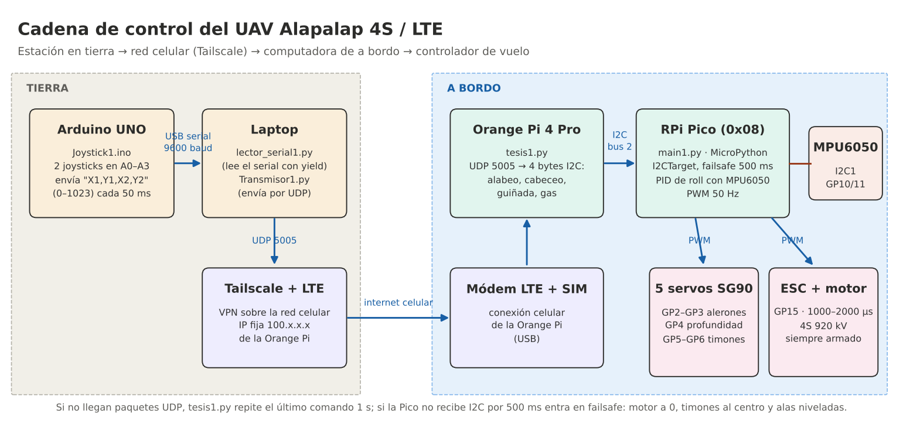
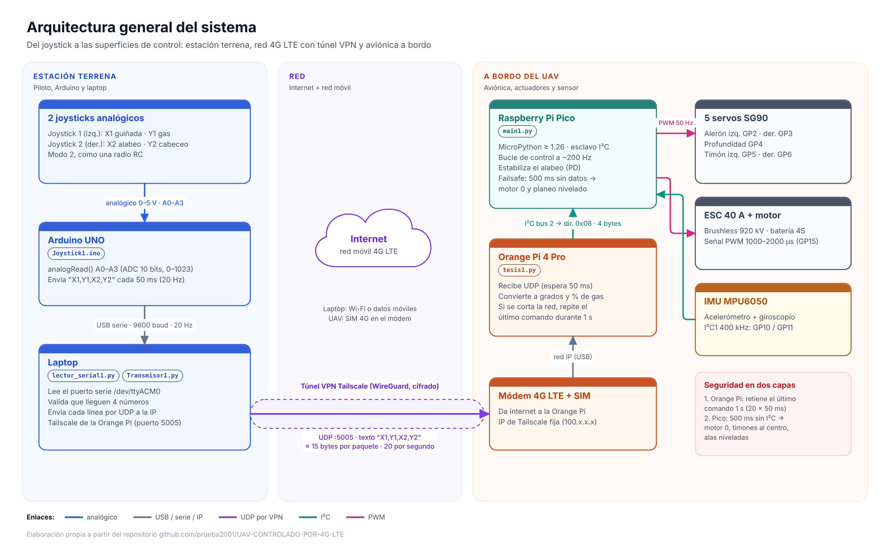
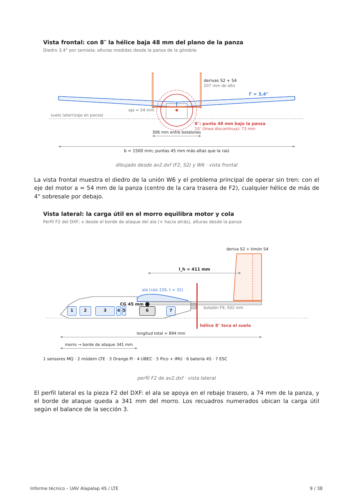

# UAV Alapalap 4S — Avión no tripulado controlado por 4G LTE

> Avión de ala fija de 1500 mm de envergadura, doble botalón y hélice propulsora, basado en el Alapalap de Julius Perdana (Paper Replika), convertido en un UAV de telemetría celular: se pilota desde una laptop con dos joysticks y los comandos viajan por internet móvil (Tailscale + módem LTE) hasta una Orange Pi 4 Pro, que los pasa por I2C a un Raspberry Pi Pico encargado de los 5 servos, el motor brushless 4S y la estabilización de alabeo con un MPU6050.

---

## 0. Estructura del Repositorio

```text
UAV-CONTROLADO-POR-4G-LTE/
├── Proyecto/                              ← Documentos del proyecto
│   ├── Informe/                           ← Informe técnico aerodinámico (PDF, 38 páginas)
│   ├── EstadoDelArte/                     ← Resumen del estado del arte (defensa, seguridad y sensores)
│   ├── Cronograma/                        ← Gantt y cronograma editable en Excel (16 oct – 15 dic 2026)
│   ├── Electronica/                       ← Alimentación, pines y solución de problemas
│   └── Mecanica/                          ← Guía de armado: ala, botalones, cola, servos, brochetas, CG
├── Resources/
│   └── Software/                          ← Todo el código del sistema
│       ├── firmware/
│       │   ├── pico_control/main1.py      ← RPi Pico: servos, ESC, MPU6050, failsafe (MicroPython)
│       │   └── Joystick1/Joystick1.ino    ← Arduino UNO: lectura de los 2 joysticks
│       ├── orangepi/tesis1.py             ← Orange Pi 4 Pro: receptor UDP → I2C
│       ├── laptop/                        ← Estación en tierra
│       │   ├── Transmisor1.py             ← Envío UDP por Tailscale
│       │   └── lector_serial1.py          ← Lectura serial del Arduino
│       ├── visor3d/alapalap_3d.html       ← Modelo 3D interactivo del avión
│       ├── Imagenes/                      ← Diagramas y láminas usadas en la documentación
│       │   ├── diagramas/                 ← 10 diagramas de electrónica y código + Gantt (PNG y SVG)
│       │   └── estado_del_arte/           ← Figuras del estado del arte
│       ├── docs/SETUP.md                  ← Puesta en marcha rápida
│       ├── docs/DIAGRAMAS.md              ← Explicación de cada diagrama
│       ├── docs/OBSERVACIONES_Y_MEJORAS.md ← Revisión del código, mejoras y transmisión de vídeo
│       ├── Estado_del_arte_UAV_4G_LTE.pdf ← Documento de estado del arte (21 páginas)
│       └── README.md
├── ArchivosCAD/
│   ├── DXF/                               ← Piezas listas para la CNC (F9, W6, W1, W5)
│   └── Planos/                            ← Planos de armado en PDF
├── avance_cronograma.png                  ← Diagrama de Gantt del proyecto
└── README.md                              ← Este archivo
```

> [!IMPORTANT]
> Los códigos de `Resources/Software/` son las versiones definitivas probadas en banco. Para que el RPi Pico arranque solo, guarda `main1.py` en la Pico con el nombre **`main.py`**.

---

## 1. Introducción y Contexto

Los drones de ala fija vuelan más lejos y más tiempo que los multirrotores con la misma batería, pero normalmente se controlan con radios de 2,4 GHz cuyo alcance práctico es de 1 a 2 km con línea de vista. Usar la **red celular 4G LTE** como enlace elimina ese límite: mientras haya cobertura, el avión puede recibir comandos y enviar datos desde cualquier lugar, igual que un teléfono.

El proyecto parte del **Alapalap**, un entrenador de espuma Depron de 5 mm con cola en H entre dos botalones y motor detrás del ala, diseñado por Julius Perdana. La hélice propulsora deja libre el morro para sensores y la góndola tiene espacio para una computadora de a bordo. Sobre esa base se cambió la planta motriz a 4S, se quitó el tren de aterrizaje (lanzamiento a mano y aterrizaje en panza) y se integró la aviónica: **Orange Pi 4 Pro** como computadora de misión, **RPi Pico** como controlador de vuelo de bajo nivel, **módem LTE** con SIM y un segundo Pico para sensores de gases tipo MQ.

El diseño se evaluó para las condiciones de Chosica (Lima, 850 m s. n. m., 25 °C).

### Estado del arte
La arquitectura del proyecto (computadora comercial a bordo, controlador de vuelo, módem 4G con SIM y enlace por internet) tiene precedentes directos en sistemas recientes de **defensa y seguridad** de bajo costo: el Molniya-2R (Raspberry Pi 5 + minicomputadora + Starlink), la réplica ucraniana del Molniya (1,5 m de envergadura, igual que este UAV), el SkyRiper Minotaur (mando por 3G/4G con túnel VPN y Raspberry Pi 5), la familia Shahed/Geran (módems 4G con SIM comerciales), el SYPAQ Corvo (placa de espuma encerada y software abierto), el Privet-82 de KB Oko (controlador de vuelo propio) y el ecosistema **Auterion OS / Skynode** (PX4 endurecido). El documento también revisa los sensores de uso común en plataformas Arduino y universitarias (serie MQ, DHT, BME280, SHT, MH-Z19, SCD41, PMS5003) y el marco regulatorio peruano.

Resumen en [`Proyecto/EstadoDelArte/`](Proyecto/EstadoDelArte/README.md) · documento completo en [`Resources/Software/Estado_del_arte_UAV_4G_LTE.pdf`](Resources/Software/Estado_del_arte_UAV_4G_LTE.pdf).

---

## 2. Objetivos

### Objetivo Principal
**Diseñar, construir y validar un UAV de ala fija teleoperado por red celular 4G LTE**, capaz de volar de forma estable con una planta 4S y de recibir comandos de control desde una estación en tierra a través de internet.

### Objetivos Específicos
* **Aerodinámica:** Calcular peso de despegue, polar, actuaciones, autonomía, estabilidad estática y dinámica, y ubicar el centro de gravedad.
* **Estructura:** Construir la aeronave en Depron con piezas cortadas por CNC (botalones de contrachapado, ala con largueros y caras dobladas).
* **Propulsión:** Integrar un motor brushless 4S de 920 kV con su ESC, siempre armado y con rampa de gas.
* **Control de vuelo:** Programar el RPi Pico para mover 5 servos (alerones, profundidad y dos timones) y estabilizar el alabeo con un MPU6050.
* **Comunicación:** Llevar los comandos del joystick desde la laptop hasta el avión por UDP sobre Tailscale y LTE, con retención y failsafe ante cortes.
* **Carga útil:** Dejar preparado un segundo Pico para sensores de gases (MQ).

---

## 3. Integrantes y Responsabilidades

| Integrante | Rol / Especialidad | Responsabilidades Principales |
| :--- | :--- | :--- |
| **Andre Sánchez** | **Diseño, electrónica y software** | Cálculos aerodinámicos, construcción del UAV, integración de Orange Pi, RPi Pico, módem LTE y sensores, programación del enlace UDP/I2C y del control de vuelo. |

---

## 4. Arquitectura del Sistema

El sistema separa **lo crítico para el vuelo** (RPi Pico: servos, motor, estabilización y failsafe) de **la comunicación y la misión** (Orange Pi + LTE). Si la red celular o la Orange Pi fallan, el Pico apaga el motor, centra los timones y mantiene las alas niveladas para que el avión planee recto.

<p align="center">
  
</p>

```text
┌──────────────────────────────── ESTACIÓN EN TIERRA ────────────────────────────────┐
│  [ 2 joysticks ] ──> [ Arduino UNO · Joystick1.ino ]                                │
│                                │  USB serial 9600 baud: "X1,Y1,X2,Y2" (0–1023)      │
│                                ▼                                                    │
│  [ Laptop · lector_serial1.py ──yield──> Transmisor1.py ]                          │
└────────────────────────────────┬────────────────────────────────────────────────────┘
                                 │  UDP puerto 5005 · VPN Tailscale · internet LTE
                                 ▼
┌──────────────────────────────────── A BORDO ───────────────────────────────────────┐
│  [ Módem LTE + SIM ] ──> [ Orange Pi 4 Pro · tesis1.py ]                            │
│                                │  I2C bus 2 · dirección 0x08                        │
│                                │  4 bytes: [alabeo, cabeceo, guiñada, gas]          │
│                                ▼                                                    │
│  [ RPi Pico · main1.py ] <── I2C1 ── [ MPU6050 ]                                    │
│        ├── PWM 50 Hz ──> 5 servos SG90 (GP2–GP6)                                    │
│        └── PWM 50 Hz ──> ESC 40 A ──> motor 4S 920 kV (GP15)                        │
└─────────────────────────────────────────────────────────────────────────────────────┘
```

| Joystick | Eje | Mando | Superficie |
| :--- | :--- | :--- | :--- |
| 1 (izquierdo) | X1 | Guiñada | 2 timones S4 (juntos) |
| 1 (izquierdo) | Y1 | Gas | Motor (solo la mitad superior da gas) |
| 2 (derecho) | X2 | Alabeo | 2 alerones (opuestos) |
| 2 (derecho) | Y2 | Cabeceo | Profundidad S3 |

### 4.1. Diagramas detallados

<p align="center">
  
</p>

| Electrónica | Código y control |
| :--- | :--- |
| [01 · Arquitectura general](Resources/Software/Imagenes/diagramas/01_arquitectura_general.png) | [05 · Recorrido de un comando (ejemplo numérico)](Resources/Software/Imagenes/diagramas/05_recorrido_comando.png) |
| [02 · Estación terrena](Resources/Software/Imagenes/diagramas/02_conexiones_estacion_terrena.png) | [06 · Flujo del código en tierra](Resources/Software/Imagenes/diagramas/06_flujo_codigo_tierra.png) |
| [03 · Pines del Raspberry Pi Pico](Resources/Software/Imagenes/diagramas/03_conexiones_pico.png) | [07 · Flujo de `tesis1.py`](Resources/Software/Imagenes/diagramas/07_flujo_tesis1_orangepi.png) · [08 · Flujo de `main1.py`](Resources/Software/Imagenes/diagramas/08_flujo_main1_pico.png) |
| [04 · Distribución de energía](Resources/Software/Imagenes/diagramas/04_distribucion_energia.png) | [09 · Lazo de alabeo](Resources/Software/Imagenes/diagramas/09_lazo_control_alabeo.png) · [10 · Failsafe](Resources/Software/Imagenes/diagramas/10_linea_tiempo_failsafe.png) |

Explicación de cada uno en [`Resources/Software/docs/DIAGRAMAS.md`](Resources/Software/docs/DIAGRAMAS.md).

---

## 5. La Aeronave

<p align="center">
  
</p>

| Parámetro | Original (plano A0) | Este proyecto |
| :--- | :--- | :--- |
| Envergadura | 1500 mm | 1500 mm |
| Superficie alar | 29,38 dm² | 29,1 dm² (cuerda 226 → 161,5 mm) |
| Peso en vuelo | 1000 g | ≈ 1050 g |
| Motor | BR2212 1400 kV | Brushless 4S 920 kV |
| Batería | LiPo 3S 2200 mAh | 4S 3300 mAh 60C (241 g) |
| Tren | Sí | No: lanzamiento a mano y aterrizaje en panza |
| Botalones F9 | Contrachapado 2 mm | Contrachapado ≈ 4 mm |
| Electrónica | Receptor RC | Orange Pi 4 Pro + RPi Pico + MPU6050 + módem LTE |

Un **modelo 3D interactivo** del avión (ala, botalones, cola, góndola, electrónica, servos, CG y mandos que mueven las superficies) está en [`Resources/Software/visor3d/alapalap_3d.html`](Resources/Software/visor3d/alapalap_3d.html). Descárgalo y ábrelo en el navegador (necesita internet para cargar three.js).

---

## 6. Protocolo de Comunicación

### 6.1. Arduino → Laptop (serial)
Una línea de texto cada 50 ms, a 9600 baud: `X1,Y1,X2,Y2\n`, con valores de 0 a 1023. `lector_serial1.py` descarta las líneas incompletas o corruptas.

### 6.2. Laptop → Orange Pi (UDP)
El mismo texto `X1,Y1,X2,Y2` por UDP al puerto **5005** de la IP de Tailscale de la Orange Pi. Al detener el transmisor se envía 5 veces el paquete neutro `512,512,512,512`.

### 6.3. Orange Pi → RPi Pico (I2C)
`tesis1.py` convierte cada eje y escribe 4 bytes desde el registro 0 del Pico (dirección `0x08`):

| Registro | Dato | Rango | Neutro |
| :---: | :--- | :--- | :---: |
| 0 | Alabeo | 0–180° | 90 |
| 1 | Cabeceo | 0–180° | 90 |
| 2 | Guiñada | 0–180° | 90 |
| 3 | Gas | 0–100 % | 0 |

Zona muerta de ±4° alrededor de 90; el gas empieza 20 cuentas por encima del centro del joystick.

### 6.4. Seguridad ante cortes
* **Retención en la Orange Pi:** si no llegan paquetes UDP, repite el último comando durante 1 s (20 ciclos de 50 ms) para aguantar cortes breves de la red.
* **Failsafe en el Pico:** si no recibe ninguna escritura I2C durante **500 ms**, pone el gas en 0, centra profundidad y timones y, si el MPU6050 funciona, sigue nivelando las alas. Al volver los datos, retoma el control solo.
* **Arranque seguro:** el Pico arranca con el motor al mínimo y las superficies al centro, y no obedece hasta recibir la primera escritura.
* **Al salir de cualquier programa** se envía todo a neutro con el motor apagado.

---

## 7. Resultados de los Cálculos Aerodinámicos

Resumen del [informe técnico](Proyecto/Informe/Informe_tecnico_UAV_Alapalap_4S_LTE.pdf):

| Magnitud | Valor de diseño |
| :--- | :--- |
| Peso de despegue (MTOW) | 1050 g (10,30 N) |
| Envergadura / superficie / alargamiento | 1500 mm / 0,291 m² / 7,74 |
| Carga alar / carga cúbica | 36,1 g/dm² / WCL 6,7 |
| Velocidad de pérdida | 8,1 m/s (29 km/h) |
| Polar | $C_D = 0{,}0395 + 0{,}0527\,C_L^2$ |
| Eficiencia máxima | L/D = 11,0 a 8,7 m/s |
| Crucero | 11–12 m/s |
| Autonomía a 12 m/s / 10 m/s | ≈ 31 min / ≈ 41 min |
| Velocidad mínima de lanzamiento | 10,2 m/s (1,25 V<sub>s</sub>) |
| Punto neutro / CG recomendado | 62 mm / **45 mm** desde el borde de ataque |
| Margen estático | 8,9 % (CG a 45 mm) |
| Envolvente | +4 / −2 g · V<sub>NE</sub> 22 m/s |

**Lanzamiento:** a mano, contra el viento, motor a fondo, alas niveladas y 5–10° de morro arriba; mantener 10–15° de ascenso hasta pasar los 20 m de altura y recién entonces pasar a vuelo horizontal.

---

## 8. Puesta en Marcha

### 8.1. Requisitos Previos
* RPi Pico con **MicroPython v1.26 o superior** (necesario para `I2CTarget`).
* Orange Pi 4 Pro con Python 3, `smbus2` y el bus I2C 2 habilitado.
* Laptop con Python 3 y `pyserial`.
* Arduino IDE para el UNO.
* Tailscale instalado y con sesión iniciada en la laptop y en la Orange Pi.

### 8.2. Orden de Ejecución
1. **RPi Pico:** copia `firmware/pico_control/main1.py` a la Pico como `main.py` (con Thonny). Al alimentarla, centra los servos, espera 3 s con el ESC al mínimo, calibra el giroscopio (no muevas el avión) y queda escuchando en `0x08`.
2. **Orange Pi:** `python3 tesis1.py` → debe mostrar *Bus I2C 2 abierto* y *Servidor UDP iniciado*.
3. **Arduino:** carga `firmware/Joystick1/Joystick1.ino` una sola vez; luego basta conectarlo por USB.
4. **Laptop:** `python3 Transmisor1.py` (importa `lector_serial1.py`, que debe estar en la misma carpeta).

Detalles, comandos y solución de problemas en [`Resources/Software/docs/SETUP.md`](Resources/Software/docs/SETUP.md) y en [`Proyecto/Electronica/`](Proyecto/Electronica/README.md).

---

## 9. Construcción

La guía de armado completa está en [`Proyecto/Mecanica/README.md`](Proyecto/Mecanica/README.md): dobleces del ala, posición de largueros, botalones y cola, huecos de los servos de alerón, brochetas para las ligas del ala y ajuste del centro de gravedad. Las piezas para la CNC y los planos en PDF están en [`ArchivosCAD/`](ArchivosCAD/README.md).

---

## 10. Estado del Proyecto y Hoja de Ruta

- [x] Informe técnico aerodinámico (38 páginas)
- [x] Enlace laptop → Tailscale → Orange Pi → Pico probado en banco
- [x] Control del motor de 0 a 100 % por joystick
- [x] Control de los 5 servos (tras unir la masa de la fuente externa con la del Pico)
- [x] Estabilización de alabeo con MPU6050 y failsafe
- [x] DXF para CNC de F9, W6, W1 y W5
- [x] Planos de armado: ala, botalones, cola, huecos de servos y brochetas
- [x] Modelo 3D interactivo
- [x] Estado del arte: precedentes de defensa y seguridad, Auterion OS y sensores Arduino (21 páginas)
- [x] Diagramas de electrónica, flujo del código, lazo de control y failsafe
- [x] Cronograma y diagrama de Gantt (16 oct – 15 dic 2026)
- [x] Revisión del código y propuestas de mejora ([`OBSERVACIONES_Y_MEJORAS.md`](Resources/Software/docs/OBSERVACIONES_Y_MEJORAS.md))
- [ ] Construcción completa de la aeronave
- [ ] Verificación del CG a 45 mm con todo instalado
- [ ] Primer vuelo con `ROLL_NEUTRO = True`
- [ ] Sensores de gases MQ en el segundo Pico y envío de telemetría
- [ ] Receptor RC de respaldo con prioridad sobre el enlace LTE
- [ ] Trámite de registro ante la DGAC
- [ ] Telemetría de retorno (batería, inclinación, señal LTE, GPS) y armado seguro del motor
- [ ] Transmisión de vídeo por Tailscale (MediaMTX) — opcional

<p align="center">
  
</p>

Plan detallado y Excel editable en [`Proyecto/Cronograma/`](Proyecto/Cronograma/README.md).

---

## 11. Documentación Complementaria

* [Informe técnico aerodinámico (PDF)](Proyecto/Informe/Informe_tecnico_UAV_Alapalap_4S_LTE.pdf)
* [Cálculos aerodinámicos previos (Google Drive)](https://drive.google.com/file/d/1UdGnhi0XhoKIerkP7uhXoAIDbuv5v3hw/view?usp=sharing)
* [Software y firmware](Resources/Software/README.md)
* [Electrónica](Proyecto/Electronica/README.md)
* [Mecánica y armado](Proyecto/Mecanica/README.md)
* [Archivos CAD y planos](ArchivosCAD/README.md)
* [Documento de Estado del Arte (PDF)](Resources/Software/Estado_del_arte_UAV_4G_LTE.pdf) · [resumen](Proyecto/EstadoDelArte/README.md)
* [Diagramas de electrónica y código](Resources/Software/docs/DIAGRAMAS.md)
* [Cronograma y diagrama de Gantt](Proyecto/Cronograma/README.md) · [Excel](Proyecto/Cronograma/Cronograma_UAV_4G_LTE.xlsx)
* [Observaciones técnicas y mejoras](Resources/Software/docs/OBSERVACIONES_Y_MEJORAS.md)
* Diseño original: **Alapalap** de Julius Perdana — [paper-replika.com](https://paper-replika.com). El plano A0 original no se incluye en este repositorio; descárgalo desde su sitio.
