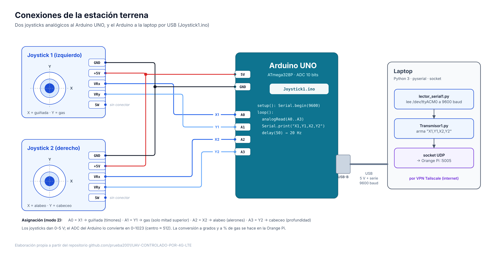
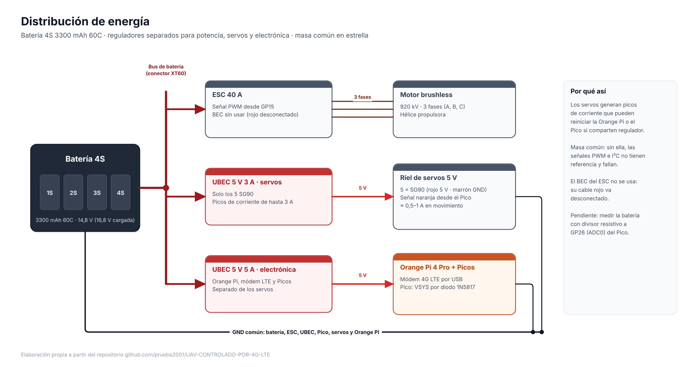
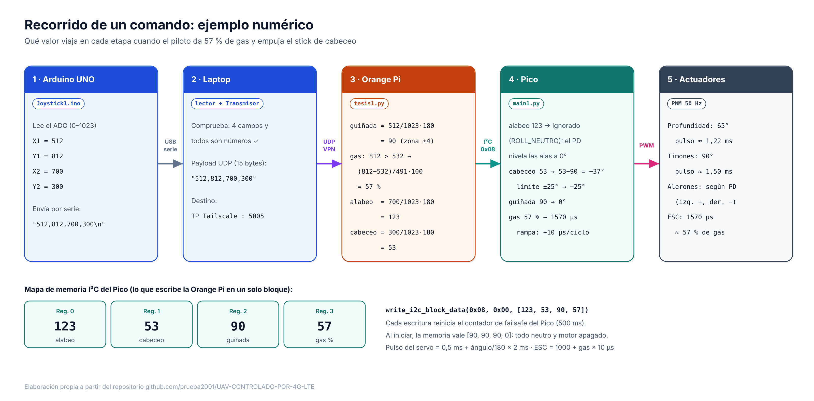
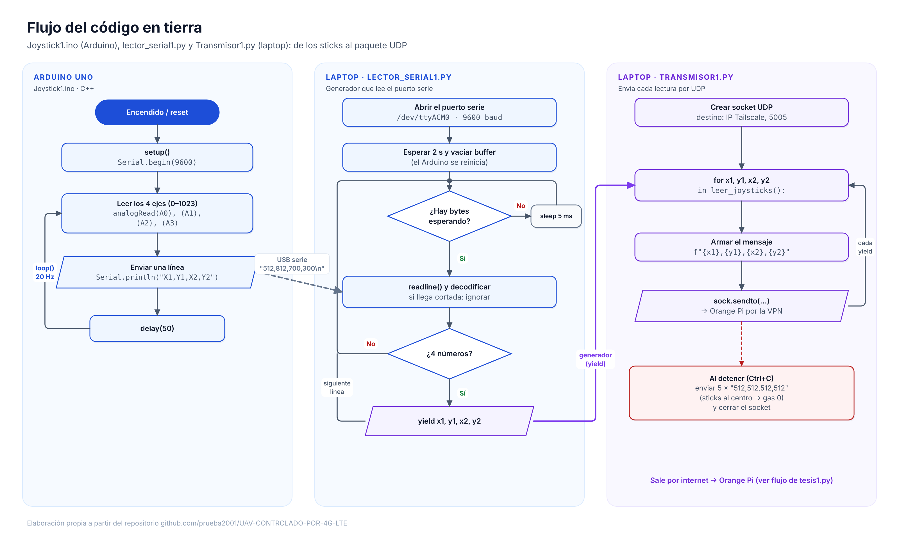
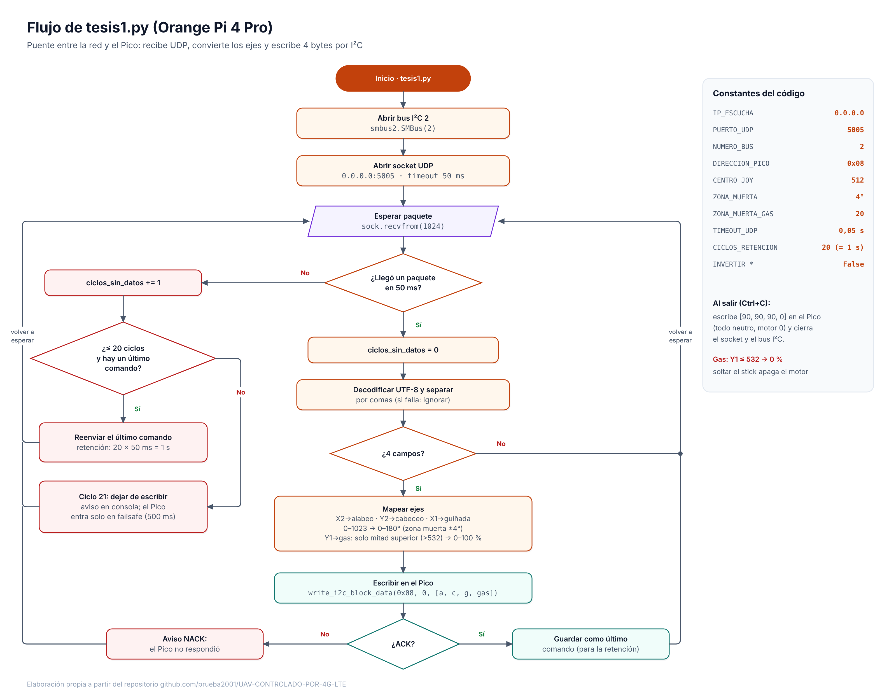
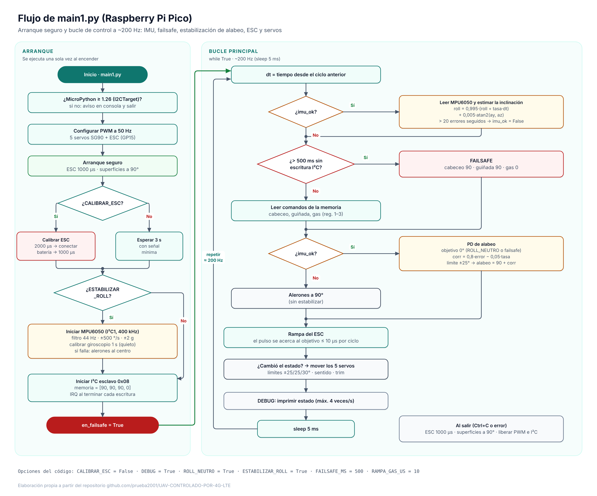
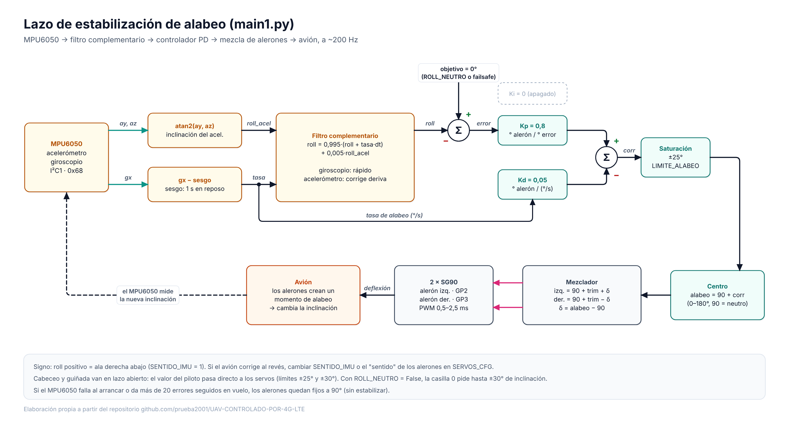
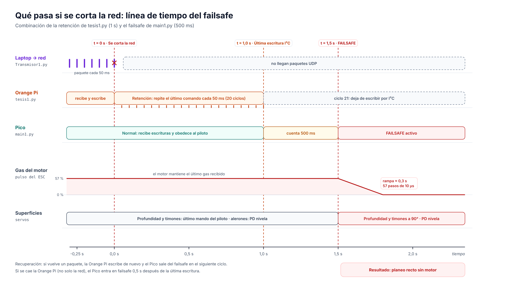

# UAV 4G LTE · Diagramas de electrónica y de código

> Diez diagramas hechos a partir de los códigos definitivos de este repositorio (`Joystick1.ino`, `lector_serial1.py`, `Transmisor1.py`, `tesis1.py` y `main1.py`) más el diagrama de Gantt. PNG a 3200 px de ancho en [`../Imagenes/diagramas/`](../Imagenes/diagramas/) y versión vectorial SVG en [`../Imagenes/diagramas/svg/`](../Imagenes/diagramas/svg/), listos para insertar en la tesis.

| N° | Diagrama | Tipo |
| :---: | :--- | :--- |
| 01 | [Arquitectura general del sistema](#01-arquitectura-general-del-sistema) | Electrónica |
| 02 | [Conexiones de la estación terrena](#02-conexiones-de-la-estación-terrena) | Electrónica |
| 03 | [Conexiones a bordo: Raspberry Pi Pico](#03-conexiones-a-bordo-raspberry-pi-pico) | Electrónica |
| 04 | [Distribución de energía](#04-distribución-de-energía) | Electrónica |
| 05 | [Recorrido de un comando con ejemplo numérico](#05-recorrido-de-un-comando-ejemplo-numérico) | Código |
| 06 | [Flujo del código en tierra](#06-flujo-del-código-en-tierra) | Código |
| 07 | [Flujo de `tesis1.py` (Orange Pi)](#07-flujo-de-tesis1py-orange-pi-4-pro) | Código |
| 08 | [Flujo de `main1.py` (Pico)](#08-flujo-de-main1py-raspberry-pi-pico) | Código |
| 09 | [Lazo de estabilización de alabeo](#09-lazo-de-estabilización-de-alabeo) | Control |
| 10 | [Línea de tiempo del failsafe](#10-línea-de-tiempo-del-failsafe) | Seguridad |
| 11 | [Diagrama de Gantt](#11-diagrama-de-gantt) | Planificación |

---

## 01. Arquitectura general del sistema
Estación terrena (joysticks → Arduino → laptop), red 4G LTE con túnel VPN Tailscale (WireGuard) y aviónica a bordo (módem → Orange Pi → Pico → servos, ESC e IMU), con el formato y la frecuencia de cada enlace.

## 02. Conexiones de la estación terrena
Los dos joysticks a A0–A3 del Arduino UNO (5 V, GND y señales), el pulsador SW sin conectar y el USB a la laptop.

## 03. Conexiones a bordo: Raspberry Pi Pico
La placa con sus 40 pines: Orange Pi en GP0/GP1 (I²C0 esclavo 0x08), servos en GP2–GP6, MPU6050 en GP10/GP11 (I²C1, 400 kHz), ESC en GP15, VSYS por el diodo 1N5817 y GP26–GP28 libres como ADC para sensores (máx. 3,3 V).

## 04. Distribución de energía
Batería 4S, ESC 40 A (BEC sin usar), UBEC 5 V 3 A solo para los servos, UBEC 5 V 5 A para la Orange Pi, el módem y los Pico, y masa común en estrella. Coincide con [`Proyecto/Electronica`](../../../Proyecto/Electronica/README.md).

## 05. Recorrido de un comando: ejemplo numérico
Con X1 = 512, Y1 = 812, X2 = 700 e Y2 = 300, la Orange Pi calcula guiñada 90°, gas 57 %, alabeo 123° (ignorado por `ROLL_NEUTRO`) y cabeceo 53°; el Pico limita el cabeceo a −25° (profundidad a 65°) y lleva el ESC a 1570 µs con rampa. Incluye el mapa de registros I²C.

## 06. Flujo del código en tierra
`Joystick1.ino` (lectura y envío cada 50 ms), `lector_serial1.py` (generador con `yield` que descarta líneas cortadas) y `Transmisor1.py` (UDP y 5 paquetes neutros al detener).

## 07. Flujo de `tesis1.py` (Orange Pi 4 Pro)
Recepción UDP con espera de 50 ms, retención de 1 s (20 ciclos) ante cortes, conversión de ejes con zona muerta, escritura I²C y manejo del ACK/NACK.

## 08. Flujo de `main1.py` (Raspberry Pi Pico)
Arranque seguro (ESC al mínimo, superficies al centro, calibración opcional del ESC, MPU6050 y giroscopio) y bucle de ~200 Hz: IMU, failsafe de 500 ms, comandos, PD de alabeo, rampa del ESC y servos.

## 09. Lazo de estabilización de alabeo
MPU6050 → filtro complementario (α = 0,995) → PD (Kp = 0,8, Kd = 0,05, Ki = 0) → saturación ±25° → mezclador de alerones (izquierdo +, derecho −) → avión.

## 10. Línea de tiempo del failsafe
Se corta la red en t = 0 → la Orange Pi repite el último comando 1 s → deja de escribir → el Pico entra en failsafe a los 1,5 s → el gas baja a 0 en ≈ 0,3 s y el avión planea recto con las alas niveladas.

## 11. Diagrama de Gantt
Plan de 9 semanas (16 oct – 15 dic 2026). Detalle y Excel editable en [`Proyecto/Cronograma`](../../../Proyecto/Cronograma/README.md).

---

> [!NOTE]
> El módem 4G se dibuja conectado por USB a la Orange Pi, como indica el esquema de alimentación. Si cambia el hardware, los SVG se pueden editar con Inkscape o cualquier editor vectorial.
